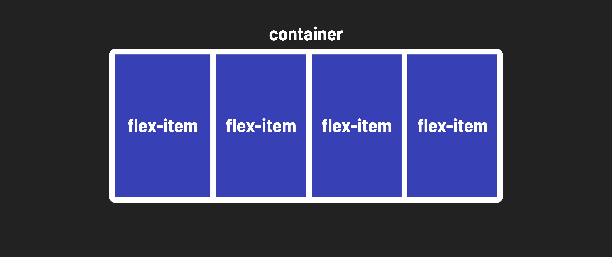
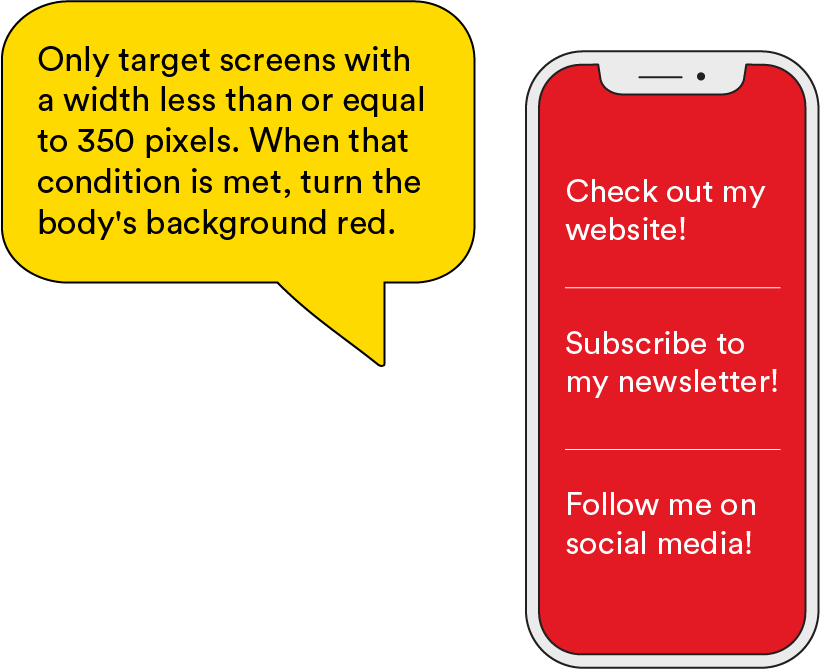
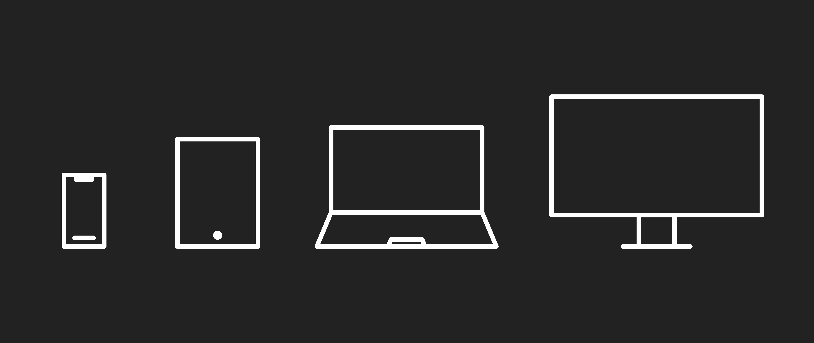
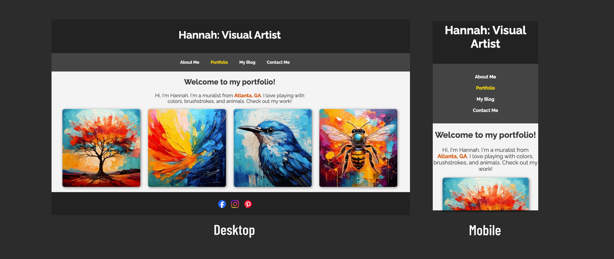

<textarea id="source">

<h1 class="slide-header">Responsive Layouts with CSS</h1>

<span id=time-estimate class="color-grey-500">30 mins</span>

<p id="lesson-description">
In our multimedia world, a website can be viewed on everything from an 8,000px monitor to a 300px phone screen! The bottom line? One size does NOT fit all. We need our content to look good, regardless of the device on which it’s seen. Luckily there are responsive layouts!
</p>

<h5 id="topics-header" class="color-grey-500">Topics</h5>

Width and Max-Width

<hr>

Media Queries

<hr>

<a href="./assets/responsive_layouts_with_css_study_guide.pdf" target="_blank" download="responsive_layouts_with_css_study_guide.pdf" class="ant-btn" data-trackable="true" data-track-category="study guide" data-track-section="lesson page" data-track-action="download study guide"><span role="img" class="anticon"><svg viewBox="0 0 16 16" width="1em" height="1em" fill="currentColor" aria-hidden="true" focusable="false" class=""><g class="download_svg__nc-icon-wrapper"><path d="M8 12c.3 0 .5-.1.7-.3L14.4 6 13 4.6l-4 4V0H7v8.6l-4-4L1.6 6l5.7 5.7c.2.2.4.3.7.3z"></path><path data-color="color-2" d="M1 14h14v2H1z"></path></g></svg></span><span> Download Study Guide</span></a>

---

<h1 class="slide-header">Learning Objectives</h1>

<p>By the end of this lesson, you'll be able to:</p>

<ul>
  <li>Use Flexbox to apply flexible alignment and spacing to layouts.</li>
  <li>Use media queries to restructure your page for different screens.</li>
  <li>Adjust the styles of HTML elements when rendered on different screens.</li>
</ul>

---

<h1 class="slide-header">Making Elements Responsive</h1>

**Width as a Percentage**

Now that we’re starting to think about **responsive design**, let’s talk about how an element’s width behaves on different screen sizes.

Right now, our images have **no width set**, so they appear at their **natural size of 300px wide**. This means:

- On a **small phone screen**, 300px might take up most of the space.
- On a **large desktop monitor**, 300px might look tiny.
- If we set a fixed width (like `width: 300px;`), the images **stay that exact size** no matter what screen they’re viewed on.

But what if we want the images to **resize dynamically** based on the screen size?

Instead of setting a fixed pixel width, we can set the width as a **percentage** of its container. This means the image will _scale_ with the screen size.

Let’s test setting the images to take up **100% of their container**:

```css
#image-container img {
  width: 100%;
  /* other styles below */
}
```

<!-- responsive-layouts-with-css-hannahs-site-12 -->
<iframe   sandbox="allow-scripts allow-top-navigation allow-top-navigation-by-user-activation allow-forms allow-popups allow-same-origin"  height="400" style="width: 100%;" scrolling="no" title="Adjusting our Content Spacing" src="https://codepen.io/GAmarketing/embed/EaxwwVZ?default-tab=css%2Cresult&editable=true" frameborder="no" loading="lazy" allowtransparency="true" allowfullscreen="true">
  See the Pen <a href="https://codepen.io/GAmarketing/pen/EaxwwVZ">
  Adjusting Width and Height</a> by General Assembly (<a href="https://codepen.io/GAmarketing">@GAmarketing</a>)
  on <a href="https://codepen.io">CodePen</a>.
</iframe>

Whoa—that might not be what we want! Let's remove that.

**What’s Happening?**

When we set `width: 100%;`, the image **expands to fill the entire width of its container**. As you resize your browser, the image **automatically adjusts** to fit the new width. On a **small phone screen**, this can look great because the image fills the available space without being too large. However, on a **huge desktop monitor**, the image might stretch too much, becoming too large and potentially losing image quality.

This is the challenge of responsive design—we want our images to **look good at every screen size**. In the next lesson, we’ll explore ways to **control how elements resize** so they stay balanced and visually appealing across all devices!

---

<h1 class="slide-header">The <code>max-width</code> Property</h1>

Right now, our images are **300px wide**, which actually works well across different screen sizes, so we don’t need to change them! However, there’s another element that could use some improvement—our **intro paragraph**.

Currently, the paragraph stretches **all the way across the screen**, making it a little strange to read, especially on larger screens. Instead of letting it span the entire width, we can use the `max-width` property to **cap its width**, keeping it more visually balanced.

Let’s try it out!

**1. Add the following to `#introduction` to limit the width of the intro paragraph while keeping it centered:**

```css
#introduction {
  /* other styles above */
  margin: 20px auto; /* Centers the paragraph */
  max-width: 600px;
}
```

By setting **`max-width: 600px;`**, the paragraph won’t stretch too wide on large screens, making it easier to read. The **`margin: 0 auto;`** ensures that the paragraph stays centered while still allowing it to shrink naturally on smaller screens. As a result, on mobile devices, the text adjusts to fit the available space without becoming too narrow or difficult to read.

<!-- responsive-layouts-with-css-hannahs-site-12 (again) -->
<iframe sandbox="allow-scripts allow-top-navigation allow-top-navigation-by-user-activation allow-forms allow-popups allow-same-origin"  height="400" style="width: 100%;" scrolling="no" title="The MaxWidth Property" src="https://codepen.io/GAmarketing/embed/EaxwwVZ?default-tab=css%2Cresult&editable=true" frameborder="no" loading="lazy" allowtransparency="true" allowfullscreen="true">
  See the Pen <a href="https://codepen.io/GAmarketing/pen/EaxwwVZ">
  The MaxWidth Property</a> by General Assembly (<a href="https://codepen.io/GAmarketing">@GAmarketing</a>)
  on <a href="https://codepen.io">CodePen</a>.
</iframe>

---

<h1 class="slide-header">Centering with the Margin</h1>

Wait, what was that `margin` property we just added... `margin: 20px auto;`?

Believe it or not, the `margin` property can do more than just add space—it can **center elements**! But there’s one catch—this only works if the element has a **defined width**.

**How it works:**

- **`margin: 0;`** → No extra space is added around the element.
- **`margin: auto;`** → Adds **equal space on the left and right**, centering the element.
- **`margin: 0 auto;`** → Centers the element **horizontally** while keeping the top and bottom margins at `0px`.
- **`margin: 20px auto;`** → Centers the element **horizontally** while adding **20px of space on the top and bottom**.

```css
#introduction {
  /* Other styles above */
  max-width: 600px;
  margin: 20px auto;
}
```

Now, instead of being stuck to the left side of the page, the paragraph sits **neatly in the center** with some extra breathing room!

---

<h1 class="slide-header">Knowledge Check</h1>

Which `margin` values could we use to **horizontally center** our content on the page?

<fieldset>
  <legend>Please select all that apply</legend>
  <input type="checkbox" id="uniqueAnswer" name="unique"/><label for="uniqueAnswer">margin: 0;</label><br />
  <input type="checkbox" id="uniqueAnswer4" name="unique4" correct="true"/><label for="uniqueAnswer4">margin: auto;</label><br />
  <input type="checkbox" id="uniqueAnswer2" name="unique2" correct="true"/><label for="uniqueAnswer2">margin: 0 auto;</label><br />
  <input type="checkbox" id="uniqueAnswer3" name="unique3"/><label for="uniqueAnswer3">margin: 50 50;</label><br />
</fieldset>

<button class="ant-btn ant-btn-primary multiple-choice-checkbox-submit">Submit Answer</button>

---

<h1 class="slide-header">Introduction to Flexbox</h1>

Now that we’ve learned about positioning and margins, let’s explore a **modern, powerful** way to control layout: **Flexbox!**

Flexbox (short for Flexible Box Layout) is a CSS tool that makes it **easier to arrange elements in rows or columns**. It helps us align, distribute, and resize elements dynamically, making layouts more _flexible_ and _responsive_.

- It allows elements to be **easily aligned** (horizontally or vertically).
- It **automatically adjusts** spacing and sizes to fit different screen sizes.
- It works great for **centering elements**, organizing grids, and handling navigation menus.

We’ll use Flexbox to improve two key areas of Hannah’s site:

1. **The Image Gallery** → Right now, the images sit in a row, but they don’t have proper spacing between them. Flexbox will allow us to **add even spacing** and also make the images **wrap** into a column layout when the screen gets smaller.
2. **The Social Media Icons** → Instead of listing them **vertically**, we’ll use Flexbox to **align them in a row** so they look clean and professional.

In the next slides, we’ll learn how to apply **Flexbox properties** to make these layouts more polished and responsive! 🚀

---

<h1 class="slide-header">Using Flexbox for Layout</h1>

To use Flexbox, we apply `display: flex;` to a **parent container**, which allows us to control how its child elements are positioned.



**1. Make an Element a Flex Container**

To start using Flexbox, apply `display: flex;` to any container element:

```css
.container {
  display: flex;
}
```

Now, all **child elements** inside the container become **flex items**, meaning we can align and position them easily!

---

<h1 class="slide-header">Align Content with Flexbox</h1>

Flexbox makes it simple to **center elements both horizontally and vertically** inside a container.

By default, children of a flex container will line up in a horizontal row - similar to how we have seen things behave when `display` is set to `inline-block`. Flex takes it a step further and allows us to set other properties that affect the alignment of those items.

```css
.container {
  display: flex;
  justify-content: center; /* Centers content horizontally */
  align-items: center; /* Centers content vertically */
}
```

**`justify-content: center;`** → Centers elements **horizontally** (left to right).  
**`align-items: center;`** → Centers elements **vertically** (top to bottom).

---

<h1 class="slide-header">Adding Space Between Items with <code>gap</code></h1>

By default, Flexbox places items **right next to each other** without any space in between. To create even spacing, we can use the **`gap` property**.

```css
.container {
  display: flex;
  justify-content: center;
  align-items: center;
  gap: 15px; /* Adds space between items */
}
```

**`gap: 15px;`** → Adds **15 pixels of space** between each item inside the container.

Unlike `margin`, **`gap` only affects the space between items**, keeping the layout more consistent.

---

<h1 class="slide-header">Wrapping Items with <code>flex-wrap</code></h1>

By default, Flexbox **keeps all items in a single row**, even if they don’t fit within the container. This can cause items to shrink too much on smaller screens.

To allow items to **wrap onto new lines** when needed, we use **`flex-wrap`**:

```css
.container {
  display: flex;
  flex-wrap: wrap; /* Allows items to wrap to a new line if needed */
}
```

**`flex-wrap: nowrap;`** (default) → **Keeps all items on one line**, even if they get squeezed.
**`flex-wrap: wrap;`** → **Moves items to the next line** when they don’t fit in the container.

This is especially useful for **image grids, navigation menus, or any layout that needs to adjust on different screen sizes**.

---

<h1 class="slide-header">Adding Flexbox to the Image Container</h1>

Now, let’s use **Flexbox** to enhance the layout of Hannah’s artwork images, making them **centered and evenly spaced** for a more polished look.

Apply `flexbox` to the artwork images:

**1. Find the parent container of the artwork `img` tags: `id="image-container"`. Since Flexbox is always applied to the **parent**, this is what we need to target.**
**2. Create a new CSS rule for `#image-container`.**
**3. Apply `display: flex;` to the parent container to enable Flexbox.**  
**4. Center the images horizontally by setting `justify-content: center;`.**  
**5. Add spacing between the images using `gap: 30px;`.**
**6. Make the images wrap to new rows on smaller screens by adding `flex-wrap: wrap;`.**

With these changes, Hannah’s image gallery will stay well-organized and adapt smoothly across different devices!

<!-- responsive-layouts-with-css-hannahs-site-13 -->
<iframe sandbox="allow-scripts allow-top-navigation allow-top-navigation-by-user-activation allow-forms allow-popups allow-same-origin"  height="400" style="width: 100%;" scrolling="no" title="Some Finishing Touches" src="https://codepen.io/GAmarketing/embed/azbLEjN?default-tab=css%2Cresult&editable=true" frameborder="no" loading="lazy" allowtransparency="true" allowfullscreen="true">
  See the Pen <a href="https://codepen.io/GAmarketing/pen/azbLEjN">
  Some Finishing Touches</a> by General Assembly (<a href="https://codepen.io/GAmarketing">@GAmarketing</a>)
  on <a href="https://codepen.io">CodePen</a>.
</iframe>

---

<h1 class="slide-header">Adding Flexbox to the Social Icons</h1>

Now, let’s use **Flexbox** to improve the layout of the **social media icons** in the footer. Right now, they may not be evenly spaced or centered, so we’ll apply Flexbox to align them properly.

**1. Find the parent container of the social icons—this is the `<ul>` inside the `<footer>`.**
**2. Use the existing CSS rule for `footer ul` and apply the following Flexbox properties: `display: flex;`, `justify-content: center;`, and `gap: 20px;`**
**3. Give the `footer` some breathing room by adding: `margin: 20px 0;` and `padding: 15px 0;`**

Once applied, the social icons will be **evenly spaced and centered**, making the footer look clean and professional!

<!-- responsive-layouts-with-css-hannahs-site-14 -->
<iframe sandbox="allow-scripts allow-top-navigation allow-top-navigation-by-user-activation allow-forms allow-popups allow-same-origin"  height="400" style="width: 100%;" scrolling="no" title="Some Finishing Touches" src="https://codepen.io/GAmarketing/embed/azbLEjN?default-tab=css%2Cresult&editable=true" frameborder="no" loading="lazy" allowtransparency="true" allowfullscreen="true">
  See the Pen <a href="https://codepen.io/GAmarketing/pen/azbLEjN">
  Some Finishing Touches</a> by General Assembly (<a href="https://codepen.io/GAmarketing">@GAmarketing</a>)
  on <a href="https://codepen.io">CodePen</a>.
</iframe>

---

<h1 class="slide-header">Media Queries: Making Your Site Responsive</h1>

Our page is looking great! Now, let’s take it a step further by making sure it looks good on **all screen sizes**.

**Media queries** allow us to apply **different CSS styles** based on conditions like **screen width, device type, or resolution**. This makes it possible to create a **responsive design**, meaning a website that adapts to different screen sizes—from large desktop monitors to small phone screens.

```css
@media screen and (max-width: 350px) {
  body {
    background-color: red;
  }
}
```

This media query tells the browser:

_"If the screen width is `350px` or smaller, change the background color of the `<body>` to `red`."_



In other words, **this style only applies when the screen is small enough to meet the condition** (`max-width: 350px`). If the screen is wider than 350px, this rule is ignored.

---

<h1 class="slide-header">Understanding Device Widths & Breakpoints</h1>

When designing responsive websites, we use **media queries** to apply styles at different **screen widths**. These width points, called **breakpoints**, help us adjust layouts for different devices like phones, tablets, and desktops.

**Common Breakpoints Used in Media Queries**



| **Device Type** | **Breakpoint (max-width)** |
| --------------- | -------------------------- |
| Small Phones    | `max-width: 480px`         |
| Large Phones    | `max-width: 600px`         |
| Tablets         | `max-width: 768px`         |
| Small Laptops   | `max-width: 1024px`        |
| Desktops        | `max-width: 1200px`        |

Example Media Query for Tablets:

```css
@media screen and (max-width: 768px) {
  body {
    background-color: lightgray;
  }
}
```

- When the **screen is 768px or smaller**, the background color changes to light gray.
- On **larger screens**, this rule is ignored.

By using breakpoints, we can create layouts that **adjust automatically** for different screen sizes, making our site look great on any device!

---

<h1 class="slide-header">Knowledge Check</h1>

Look at the following media query. What happens when the screen width is **600px or smaller**?

```css
@media screen and (max-width: 600px) {
  body {
    background-color: lightgray;
  }
  h1 {
    font-size: 24px;
  }
}
```

<fieldset>
  <legend>Select one option:</legend>

  <input type="radio" name="action" id="option1" value="option1" />
  <label for="option1">The body background will always be light gray, and the h1 will always have a font size of 24px, no matter the screen size.</label><br /><br />

  <input type="radio" name="action" id="option2" value="option2" correct="true"/>
  <label for="option2">When the screen is 600px or smaller, the body background will change to light gray, and the h1 font size will become 24px.</label><br /><br />

  <input type="radio" name="action" id="option3" value="option3" />
  <label for="option3">When the screen is exactly 600px, the body background will turn light gray, and the h1 font size will become 24px.</label><br /><br />

  <input type="radio" name="action" id="option4" value="option4" />
  <label for="option4">When the screen is larger than 600px, the body background will turn light gray, and the h1 font size will become 24px.</label><br /><br />

</fieldset>

<button class="ant-btn ant-btn-primary multiple-choice-radio-submit">Submit Answer</button>

---

<h1 class="slide-header">Media Queries for Our Navigation</h1>

Right now, Hannah’s navigation bar looks great on **larger screens**, where the links sit neatly in a row. But on **smaller screens**, they can feel **cramped and hard to tap**.

To improve readability and usability on **mobile devices**, we will:

- **Stack the navigation links vertically** instead of keeping them in a row.
- **Center the links** to keep the layout clean.
- **Add spacing** between each link to make them easier to tap.

We can accomplish this using a **media query**, which will automatically apply these changes when the screen width gets smaller.

---

<h1 class="slide-header">Adjust the Navigation for Mobile</h1>

Let’s update the navigation bar so it looks better on **small screens** by applying a **media query**.

**1. At the bottom of your CSS, below all existing styles, add the following `media query`:**

```css
@media screen and (max-width: 600px) {
  nav ul {
    display: flex;
    flex-direction: column;
    align-items: center;
    padding: 0;
  }

  .nav-item {
    display: block;
    margin: 10px 0;
  }
}
```

This media query:

- **Stacks the navigation links** in a vertical column using `flex-direction: column;`.
- **Centers the links** using `align-items: center;`.
- **Adds space between links** with `margin: 10px 0;` to make them easier to tap on touch screens.

Now, **resize the browser** or view the site on a **mobile screen** to see the navigation adjust automatically! 🎉

<!-- responsive-layouts-with-css-hannahs-site-15 -->
<iframe sandbox="allow-scripts allow-top-navigation allow-top-navigation-by-user-activation allow-forms allow-popups allow-same-origin"  height="400" style="width: 100%;" scrolling="no" title="Some Finishing Touches" src="https://codepen.io/GAmarketing/embed/azbLEjN?default-tab=css%2Cresult&editable=true" frameborder="no" loading="lazy" allowtransparency="true" allowfullscreen="true">
  See the Pen <a href="https://codepen.io/GAmarketing/pen/azbLEjN">
  Some Finishing Touches</a> by General Assembly (<a href="https://codepen.io/GAmarketing">@GAmarketing</a>)
  on <a href="https://codepen.io">CodePen</a>.
</iframe>

---

<h1 class="slide-header">Hannah’s Site is Complete! 🎉</h1>

Great job! You’ve successfully built a **responsive portfolio site** for Hannah. Now, whether visitors are browsing on a **desktop** or a **mobile device**, the site looks polished, well-structured, and easy to navigate.

**What You’ve Accomplished:**  
✅ Styled the **navigation bar** to adjust for different screen sizes.  
✅ Created a **responsive image gallery** that adapts to mobile layouts.  
✅ Used **Flexbox** to improve spacing and alignment.  
✅ Applied **media queries** to make the site look great on any device.



Your skills in **HTML & CSS** have helped bring Hannah’s portfolio to life. Keep practicing and experimenting—this is just the beginning of your web development journey! 🚀

---

<h1 class="slide-header">Responsive Design: Pro Tips</h1>

When designing for different screen sizes, keep these essential tips in mind:

1. **Think Mobile-First**

   - Many users browse on phones first! Start with a **simple, flexible layout** and adjust for larger screens.

2. **Test Your Layout on Different Screen Sizes**

   - Use your browser’s **developer tools** (right-click → Inspect → Toggle Device Mode) to see how your site looks on various devices.

3. **Let CSS Handle the Adjustments**
   - Your **HTML stays the same**—you only need **CSS (like Flexbox and Media Queries)** to adjust layouts for different screen sizes.

Want to dive deeper into responsive design? Check out the  
<a href="https://learn.shayhowe.com/advanced-html-css/responsive-web-design/" target="_blank" rel="noreferrer noopener">Responsive Design Primer</a>

---

<h1 class="slide-header">Conclusion</h1>

Still curious about responsive design? Here are some great resources to deepen your understanding:

- <a href="http://cssmediaqueries.com/overview.html" target="_blank" rel="noreferrer noopener">A guide to writing media queries</a> for common screen sizes.
- <a href="https://www.bitdegree.org/learn/css-max-width" target="_blank" rel="noreferrer noopener">Tips for using the `max-width` property</a> to improve layout flexibility.
- <a href="https://css-tricks.com/snippets/css/a-guide-to-flexbox/" target="_blank" rel="noreferrer noopener">CSS Tricks: A complete guide to Flexbox</a> for mastering flexible layouts.
- <a href="https://www.creativebloq.com/rwd/responsive-web-design-tutorials-71410085" target="_blank" rel="noreferrer noopener">More responsive design tutorials</a> to expand your skills.

These resources will help you continue building **responsive, mobile-friendly** websites with confidence!

</textarea>
